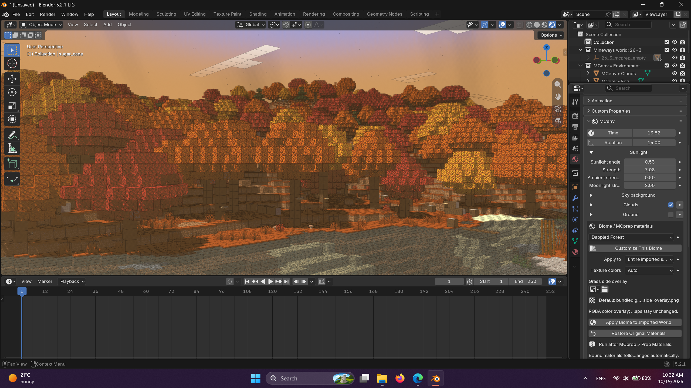

# 🟩 MCenv 1.0.0

  

  

A **Minecraft-inspired environment add-on** for **Blender 4.2+**  
🌞 Sun • 🌙 Moon Phases • ⭐ Square Stars • ☁️ Block Clouds • 🌫️ Fog & Wind — all in one panel.

 

### 👉 Open **Properties ▸ World ▸ MCenv ▸ Create Environment**

---

## 🚀 Included Features

<table>
<tr>
<td width="33%" valign="top">

### 🌅 Sky & Celestial

- Direction-based **sun**
- **Eight** selectable moon phases
- Seeded **square stars**
- Custom image backgrounds

</td>
<td width="33%" valign="top">

### 💡 Lighting & Color

- Separate directional + ambient controls
- Day/night scene colors
- Optional **twilight**
- Biome-derived sky color

</td>
<td width="33%" valign="top">

### ☁️ Atmosphere & Fog

- **Block clouds** (Normal / Faded / Flat)
- Optional textured ground
- **Physical fog**
- Overworld / Nether / End atmospheres

</td>
</tr>
<tr>
<td valign="top">

### 🎨 Textures & Biomes

- Filtered biome choices
- Main / BB texture alternatives
- Reversible **tint binding**
- MCprep-compatible tint stages
- RGBA grass-side overlays

</td>
<td valign="top">

### 🌿 Animation & Wind

- Managed **plant/leaf wind**
- Custom vertex weights (`MCENV_Wind`)
- Texture-strip animation
- Day-cycle option

</td>
<td valign="top">

### 🛠️ Tools & Presets

- Consistently aligned **Animate / Wind / Blender tools** foldouts
- Selected-object wind
- **JSON** environment presets
- Reset & environment removal

</td>
</tr>
</table>

---

## 📝 Notes

- Shipped defaults use **Java celestial-card proportions** for light angles and a documented **Vibrant Visuals moon/sun intensity ratio of 0.4/100**.
- Blender sunlight defaults to **3**, moonlight to **0.012**, sprite scales to **2.3** and **2.0**, and independent light angles to about **8.578307°** and **5.724810°**.
- These are **Blender mappings**, not a claim that Minecraft light levels are physical light units.  
  Existing saved values are **not overwritten automatically**.

---

## 📦 Installation and Use

> ⚠️ **Back up your `.blend`** before replacing an installed copy.

<table>
<tr><td align="center"><b>Step 1</b></td><td>Install <code>MCenv-1.0.0.zip</code> through <b>Preferences ▸ Add-ons ▸ Install from Disk</b> — the archive contains a Blender extension manifest with ID <code>mc_env</code></td></tr>
<tr><td align="center"><b>Step 2</b></td><td>When replacing the same version, <b>disable the previous copy</b> and <b>restart Blender</b> so cached modules are not reused</td></tr>
<tr><td align="center"><b>Step 3</b></td><td>Open <b>Properties ▸ World ▸ MCenv ▸ Create Environment</b></td></tr>
<tr><td align="center"><b>Step 4</b></td><td>Use <b>Rendered View</b>, or enable <b>Scene World</b> + <b>Scene Lights</b> in Material Preview. Solid View does not evaluate the World shader. Turn <b>Render ▸ Film ▸ Transparent</b> off if the sky should appear</td></tr>
</table>

MCenv does **not** change your render engine, exposure, user lights or camera clipping. Settings are stored **per scene**. The previous World is preserved for **Remove Environment**; MCenv creates its own collection, lights, World and support meshes. Bundled images are loaded locally and packed on use. **No runtime network access** or third-party Python dependency; **MCprep is optional**.

📖 Full workflows, numeric defaults, derivations, references and limitations: **[USER_GUIDE.md](docs/USER_GUIDE.md)**

---

## 🗂️ Panel Layout

The section order is: **Sunlight** ▸ **Sky Background** ▸ **Scene Colors** ▸ **Clouds** ▸ **Ground** ▸ **Fog** ▸ **Biomes / Dimensions** ▸ **Animate** ▸ **Wind** ▸ **Blender tools**

Blender tools uses the same collapsible header implementation as Animate, Wind and the other foldouts, immediately below Wind. It has no enable checkbox because its buttons perform actions rather than toggle an effect. Clouds, Ground, Fog, Animate and Wind have header enable switches. Native property decorators and right-click menus provide keyframing where supported. **Foldout states are UI-only and excluded from presets.**

---

## 🕐 Time and Rotation

- **Time** is in hours: `0` = midnight, `6` = sunrise, `12` = noon, `18` = sunset. Dragging past a full day wraps around.
- **Rotation** changes the environment heading in degrees and wraps into `-180` to `180`.
- Click either named button to open a **circular dial**. Move outside its center to adjust, then click or press `Enter` to confirm. Click the center for numeric entry. Scroll changes Time by **one minute** or Rotation by **one degree**. `Escape`/right-click cancels and restores the starting value.
- Right-click the button and select **Add to Quick Favorites**, or invoke **MCenv Time / MCenv Rotation** through `F3`. Blender favorites are editor-specific.

The sun and moon are **opposite one another**. The orbit passes overhead; this is not a real-world latitude or seasonal solar model. Time controls atmosphere **independently of the timeline** unless **Animate day cycle** is enabled.

---

## ☀️ Sunlight and Minecraft Reference Defaults

### What the reference numbers mean

Minecraft Wiki distinguishes **sky light**, **internal sky light** and **rendered brightness**. Exposed sky light remains `15` even at night; internal sky light is `15` at clear noon and `4` at midnight. Those integer game-logic levels are **not watts, lumens or Blender light energy**, and `4/15` is not a physical moon/sun brightness ratio. Rendered appearance also depends on the game's brightness setting.

The Wiki separately reports generic **Vibrant Visuals** direct sunlight of **100** and moonlight of **0.4** (using the Wiki's term, *lumen*). These values are specific to that rendering mode and can vary by biome. MCenv uses their **0.004 moon/sun ratio**, not their absolute units, as a practical default for its directional lights. It retains the existing daylight calibration of `3` Blender energy units, so moonlight defaults to `3 * 0.4 / 100 = 0.012`. This is an **explicitly chosen Blender mapping**, not a physically exact conversion or a claim to reproduce vanilla Java's lightmap. Ambient strength remains an independent artistic setting at `0.5`.

### Numeric defaults

| Section | Property | Default | Meaning |
| --- | --- | ---: | --- |
| Sunlight | Sunlight angle | 8.578306658° | Shadow-source size matched to the Java sun's central square |
| Sunlight | Strength | 3.0 | Existing Blender daylight energy calibration |
| Sunlight | Ambient strength | 0.5 | Independent World ambient multiplier |
| Sunlight | Moonlight angle | 5.724810452° | Independent shadow-source size matched to the Java full-moon square |
| Sunlight | Moonlight strength | 0.012 | 0.004 of the default daylight energy |
| Sky Background | Sun scale | 2.3 | Default sun sprite size multiplier in MCenv's existing scale units |
| Sky Background | Moon scale | 2.0 | Default moon sprite size multiplier in MCenv's existing scale units |
| Sky Background | Sun angle / Moon angle | 0° | Sprite rotation within its plane, not source size |
| Sky Background | Moon phase | Full Moon | Initial bundled phase |

> Blender's UI rounds displayed values; the defaults are computed at **full floating-point precision**. The two light-source angles are independent of the sprite scales. Their matching defaults are a **shadow-softness approximation**: Minecraft's displayed square is not Blender's circular SUN emitter, and vanilla Java does not use this soft-shadow model.

### Size calculation and source boundaries

The Wiki Sun and Moon pages do not provide a precise, universal angular size or a physical distance. For size, MCenv instead uses the Java renderer's projection: the **sun card has half-width 30 at distance 100**; the **moon card has half-width 20 at distance 100**. These are camera-relative rendering coordinates, **not physical celestial diameters in blocks**.

A full card therefore subtends:
- Sun: `2 * atan(30 / 100) = 33.398488468°`
- Moon: `2 * atan(20 / 100) = 22.619864948°`

The bundled **Main 32 × 32** images have a central **8 × 8** body, one quarter of the card width. Their central square widths are consequently:
- Sun: `2 * atan(0.3 * 8 / 32) = 8.578306658°`
- Moon: `2 * atan(0.2 * 8 / 32) = 5.724810452°`

The rest of each card contains glow/background, not additional solid body. MCenv's existing perspective UV projection spans `0.18 * scale`. The defaults are `2.3` for Sun scale and `2.0` for Moon scale; a scale of `0.6 / 0.18` for the sun or `0.4 / 0.18` for the moon reproduces the Java card ratios. BB and custom images may have different body/glow margins, so their visible cores need not match these Main-image measurements. Bedrock can vary apparent sun size with viewing direction and time; **that effect is not implemented**.

### Lighting behavior

Strength is faded by the day/night blend before being assigned to the Sunlight/Moonlight SUN objects. At clear noon the default Sunlight energy is `3` and Moonlight energy is `0`; at midnight those energies are `0` and `0.012`. Twilight warms the sunlight near the horizon. The existing sun tint and blue moon tint are preserved; this is not a complete implementation of Vibrant Visuals biome-dependent colors or intensity.

Setting a sprite scale to zero hides the image and its star mask but **does not turn its light off**. Use the corresponding **Strength** for that. Nether and End suppress both directional lights without deleting them. Existing saved values and imported presets are not forcibly overwritten by new defaults. To adopt all non-image defaults in an existing scene, use **Blender tools ▸ Reset Environment Settings**; this also resets other environment options. Alternatively, reset individual properties through Blender's right-click menu.

---

## 🌌 Sky Background

### Minecraft mode

Sun, moon and stars are **direction-based World shader layers**, not a finite dome or distant mesh cards. Moving the camera does not change their apparent distance or scale. Foreground geometry and physical fog can still occlude them. The visible background is separated from the independently controlled ambient shader.

- **Sun textures**: `Main`, `BB` or `BB Celestial`. Main uses `textures/environment/main/celestial/sun.png`; BB uses `textures/environment/bb/sun.png`; BB Celestial uses `textures/environment/bb/celestial/sun.png`.
- **Moon textures**: `Main` or `BB`, each with **eight separate phase images** under `textures/environment/<set>/celestial/moon/`.
- **Sun texture / Moon texture**: optional custom image overrides. An empty field uses the bundled selection. Clear an override with `X` to restore it.
- **Moon phase**: Full Moon, Waning Gibbous, Last Quarter, Waning Crescent, New Moon, Waxing Crescent, First Quarter, Waxing Gibbous. Last Quarter loads `third_quarter.png`. The phase is selected **manually**; it does not advance automatically as days pass. Custom moon overrides are single static images, not split phase sheets.
- **Sun angle / Moon angle**: in-plane sprite tilt. **Sun scale / Moon scale**: apparent size multipliers; zero hides the respective sprite.
- **Twilight**: warm sunrise/sunset blending, with a left-aligned checkbox. It does not overwrite saved day/night colors and is suppressed outside the Overworld.

Opaque bundled black-backed celestial images use **additive compositing**, avoiding black cards. Their central body and bright sprite pixels mask stars. Custom RGBA images use their alpha, so transparent pixels reveal stars. Supply alpha yourself for a custom black-backed RGB image if its border should be transparent. **Closest filtering** preserves pixel edges. Changing the lunar phase changes artwork, not light energy or the circular shadow-source size.

### Stars

Star count, Star size, Random star size and Star brightness control a **seeded square-star layer**; the Night Stars color is in Scene Colors. Random star size zero gives uniform sizes. Stars fade in after sunset and out near sunrise. Their seeded directions are stable and Rotation turns the pattern; a full time-driven starfield orbit is not implemented.

A packed **4096 × 2048** directional mask rebuilds only when count, size or size randomness changes. Brightness, color, Time and Rotation do not rebuild it. Sub-texel stars bake one texel whose brightness matches their relative size, so Random star size stays visible at small sizes. Large edits can pause Blender and use substantial memory. Old MCenv-owned star/celestial meshes are replaced by World layers during synchronization; unrelated user objects are preserved.

### Custom mode

Choose a **Background image** and an **Image type**:

| Image type | Use |
| --- | --- |
| **Equirectangular** | Panoramas / HDRIs |
| **Image** | Camera-facing flat image with optional Stretch |
| **Box** | Repeating box projection |

Image rotation is available for panorama/box modes. Minecraft sprites and stars are hidden. **Custom backgrounds are camera-only**; an HDRI here does not automatically become an HDRI illumination setup. Directional and ambient lighting remain separate, including dimension lighting rules.

---

## 🎨 Scene Colors

Day controls are **Sky**, **Clouds**, **Sunlight** and **Ambient**. Night controls are **Sky**, **Clouds**, **Stars** and **Ambient**. Time blends between them. **Biome sky color** can derive the Overworld daytime sky from biome temperature while preserving the manually selected day/night colors. Nether and End always retain their own atmosphere unless the visible background is overridden with Custom mode.

---

## ☁️ Clouds

Enable Clouds and select one of:

| Mode | Behavior |
| --- | --- |
| **Normal** | Solid block clouds |
| **Faded** | Semi-transparent blocks |
| **Flat** | Tiles |

Controls include **Cloud texture**, **Speed**, **Offset**, **Height**, **Scale**, **Size**, **Thickness**, **Coverage** and **Seed**.

A custom Cloud texture uses **brightness multiplied by alpha** as a mask. Without one, a **seeded procedural field** determines coverage. **Scale** sets the base 32-cell field width; **Size** adds a block column on every side per step without resizing the existing cells. **Thickness zero** also creates flat tiles. Movement is along the **X axis** and depends on **timeline seconds**, **Speed** and **Offset**, independently of Animate and Wind. Clouds are finite meshes; they are **hidden in Nether and End** without changing their saved enable setting. Bundled cloud images are included assets, but the default field is procedural until a Cloud texture is chosen.

---

## 🌍 Ground

Ground is **disabled by default**. It adds a background plane, **not a terrain generator**, and never changes imported blocks. The plane is **1024 units wide at Z = -0.02**, with one-unit texture repetition.

- **Ground texture** is optional; empty uses `textures/block/main/grass_block_top.png`, independently of the Biome Block textures selector.
- **Surface follows biome** changes tint and shading to grass, sand, snow, stone or water **without replacing the selected texture**. Compensation for already colored images is approximate. With this option off, custom images retain their colors, while bundled grayscale grass uses a fixed Plains tint.

---

## 🌫️ Fog

Fog is a **physical volume** in a finite **2048-unit-wide box**. **Distance** is the start distance from the active camera (the origin is used when no camera exists); **Size** is the falloff span; **Height** is the volume height. **Affect sky**, **Custom sky color** and **Custom object color** are separate controls. Even with Affect sky off, the physical volume can attenuate rays toward the sky; it is not a guarantee of an unattenuated background. Moving a free viewport does not replace the active camera used for fog distance.

---

## 🧭 Biomes / Dimensions

Select **Dimension** first, then a biome from its filtered list. **Custom** is available in every dimension. Returning to a dimension **restores its remembered biome and fog Distance/Size**. Manual scene colors and saved Clouds/Twilight switches are **not overwritten**. Preset JSON stores the active dimension and settings, **not the complete history** of per-dimension selections.

- **Overworld** includes Plains, forests, taigas, snow and mountain variants, deserts, savannas, jungles, swamps, rivers, beaches, oceans, Badlands, Mushroom Fields, Cherry Grove, Pale Garden, Dappled Forest and **The Void**. *The Void is an Overworld superflat biome, not an End dimension.*
- **Nether** includes Nether Wastes, Soul Sand Valley, Crimson Forest, Warped Forest and Basalt Deltas.
- **The End** includes The End, Small End Islands, End Midlands, End Highlands and End Barrens. *Their terrain differences are not generated.*

Nether and End use **constant dim ambient light**, with sun/moon illumination, celestial artwork, stars and clouds suppressed. User lights, wind and stored animation options are unaffected. The End uses a **direction-projected repeating Main or BB End texture** on six faces, **sixteen repeats** along each face. Main receives a dark purple tint; BB receives neutral darkening.

| Nether biome | Default display-RGB fog color |
| --- | --- |
| Nether Wastes | `#330808` |
| Soul Sand Valley | `#1B4745` |
| Crimson Forest | `#330303` |
| Warped Forest | `#1A051A` |
| Basalt Deltas | `#685F70` |

Nether's initial fog starts at **10** with an **86-unit falloff**. End's default object fog is `#181318`, a darkened representation of the Java base `#A080A0`. These are **Blender atmospheric approximations**, not Minecraft's screen-space fog algorithm.

### Imported-world materials

1. Import your world. If using **MCprep**, run **Prep Materials** first.
2. Select **Dimension** and **Biome**, then set **Apply to** to the entire scene or selected objects.
3. Click **Apply Biome to Imported World**. Supported material slots receive **scene-owned copies**, preserving originals. Bound copies follow subsequent biome changes.
4. **Reapply** after another import, material preparation, or changing the binding scope/texture-color mode. Use **Customize This Biome** to copy current tints into Custom.
5. Use **Restore Original Materials** in the desired scope to restore tracked slots. Slots replaced manually are not overwritten with stale data.

Detection uses **material/image names** and **MCprep metadata**. Supported categories include grass and grass sides, leaves, vines, water, sugar cane/reeds, bushes, ferns, separate flower stems and leaf litter. Dry foliage has its own color. Spruce and birch keep fixed Java-style tints. Colored petals and unrelated blocks are not automatically tinted.

**Texture colors** supports:

| Mode | Behavior |
| --- | --- |
| **Auto** | Reuse MCprep's active tint stage when possible |
| **Grayscale** | Apply tint as-is |
| **Already colored** | Compensate for baked colors |

Baked-color compensation is approximate. Supported diffuse workflows preserve alpha, normal, bump and roughness branches. Nested shader groups, multiple diffuse images and combined atlases can require manual preparation.

**Block textures** selects **Main/BB grass-side overlays**. **Grass side overlay** accepts a custom RGBA image, packed by the image loader. Empty uses the bundled overlay for the selected set. It follows diffuse UVs and composites tinted grass over original dirt; it **does not replace the normal map**. The automatic side workflow requires a **square, flat-projected diffuse image**.

Bindings use **object-linked material slots** to avoid changing unselected objects sharing a mesh. Linked/override data and objects shared across scenes are skipped where unsupported. This is not spatial biome blending or a Minecraft metadata importer.

---

## 🌿 Animate and Wind

Animate is **enabled by default**, but **Animate day cycle is off** and no object is added automatically.

### Day cycle
- **Animate day cycle** advances from manual Time at the **scene start frame**.
- **Frames per day** defaults to **2400**. This is a Blender animation duration, **not automatically Minecraft's real-time 20-minute cycle**.

### Texture animation
- **Texture animate** plays opted-in **vertical strips of square frames**. Select suitable meshes and use **Add Selected Texture Strips**.
- Relevant materials are copied and UVs adjusted; **Texture animation speed** is **strip FPS (default 20)**, not scene FPS. This does **not** parse `.mcmeta` timing, arbitrary atlases or interpolation. Disabling Texture animate or Animate selects the first frame without removing the binding.

### Object motion
- The **Objects** picker with **Add / Add Selected** maintains an explicit motion list. Each entry has **enable**, **Motion**, **Influence** and **X removal**. Additions do not stack duplicate effects.

**Motion types:**

| Motion | Behavior |
| --- | --- |
| **Auto** | Leaf-name recognition vs. root-pinned plant sway |
| **Grass / plant** | Pin the base of each disconnected mesh island |
| **Leaves** | Full-weight flutter |
| **Custom weights** | Preserve/paint `MCENV_Wind` |

Weight `0` pins a vertex; `1` gives full movement. Existing weights select **Custom** when first added. **Influence** scales an individual response.

Play or scrub the timeline and enable **Wind**. **Speed** drives local waves; **Strength** sets displacement amplitude; **Direction** sets world-space heading; **Directional speed** controls traveling gusts; **Directional strength** scales their contribution. Motion uses **spatially varying three-axis waves, gusts and plant/leaf masks**. Deterministic frame/FPS evaluation needs **no simulation bake**. Speed zero freezes the spatial pose; disabling Wind, Animate or an entry returns managed objects to undeformed output. Cloud motion and user-authored animation are unaffected.

**X** removes only the managed modifier and entry, preserving the object, base mesh, materials, transforms, keyframes and vertex weights. Deleted objects leave removable missing entries. **Skipped targets:** shared meshes, linked/override objects, cross-scene objects, non-meshes, edit-mode meshes and MCenv rig objects. Separate mixed terrain/vegetation or paint Custom weights. **Welded plants are treated as one island.** This is **stylized deformation, not botanical physics**.

---

## 🛠️ Blender Tools

| Action | Description |
| --- | --- |
| **Add Wind to Selected / Remove Wind from Selected** | Direct selected-object wind workflow. Uses **height-based weights** for the whole mesh rather than per-island managed motion. Adding direct wind recalculates its height weights; paint them afterward as needed. Direct wind respects **Wind** but not the **Animate master**. Adding an object to Animate **replaces** its direct wind modifier so effects are not doubled. Removing direct wind does not remove managed Animate entries or weights. |
| **Import preset / Export preset** | JSON environment settings, active dimension/biome and colors. Format: `{"format": "MCenv", "version": 1, "settings": {...}}`. Import **validates** values before application and applies **Dimension before Biome**. Unknown fields, invalid values or mismatched dimensions/biomes are **rejected**. Image pointers, object references, material bindings, per-object animation settings, weights, keyframes and foldout states are **excluded**; save the `.blend` for those. |
| **Reset Environment Settings** | Restores preset-eligible, non-image settings to their **declared defaults**, including lighting and sprite sizes, and clears remembered dimension choices. Images, object lists, bindings, weights and keyframes are **retained**. Existing keyframes can still drive reset values on later frames. |
| **Remove Environment** | Removes this scene's owned rig and **restores its previous World**. Managed/direct wind effects, bound imported materials and saved tool data are **not removed automatically**. Remove Animate entries/direct wind and restore materials first if you want those effects removed too. |

---

## 💾 Files and Data

| File / Folder | Role |
| --- | --- |
| `__init__.py`, `blender_manifest.toml` | Metadata and registration |
| `properties.py` | Scene settings, biome tables, lighting defaults and update callbacks |
| `engine.py` | Owned environment data, shader layers, clouds, fog, ground and wind/animation nodes |
| `ui.py`, `overlay.py` | World panel and modal Time/Rotation dials |
| `operators.py` | Creation/removal, image loading, material/animation actions and JSON presets |
| `biome_materials.py` | Supported material detection, reversible copies and tint/overlay processing |
| `assets.py`, `textures/` | Local bundled image loading and packing |
| `preferences.py` | Preferences and Blender-managed uninstall |
| `LICENSE` | GPL-3.0-or-later for the code; supplied texture rights remain separate |

Settings, images, object references, bindings and node groups live in the `.blend`. Presets contain **non-image environment values**, not object lists, weights, keyframes or image files. **No database, hosted service, API key or network connection** is needed. There are no web routes or production deployment URLs: this is a **locally installed Blender add-on, not a website**.

---

## 💾 Saving, Replacing and Uninstalling

- Save the `.blend` for settings, packed images, material records, object entries and node groups. Use **File ▸ External Data ▸ Pack Resources** for external custom textures. **Keep MCenv enabled when rendering frame-dependent effects** — their update handlers require it.
- Replacing the add-on does **not retroactively remove** modifiers or node groups already embedded in an old `.blend`. If an older build left an unwanted effect on a mesh, remove its saved modifier in Blender before continuing. **Back up the file first.** New defaults do not overwrite explicit saved values.
- **Preferences ▸ MCenv ▸ Uninstall MCenv** delegates to Blender's package manager, protects development/system locations and **does not delete saved scenes**. Save before uninstalling. Reinstall/enable MCenv to resume procedural per-frame updates.

---

## ⚠️ Scope and Known Limits

> 🚫 **Not implemented:**
> - Terrain import/generation
> - Weather simulation
> - Snowfall
> - Automatic lunar calendar
> - End-flash animation
> - Arbitrary-atlas playback
> - Full Minecraft light propagation
> - Biome noise blending
> - Vibrant Visuals renderer
> - Full Minecraft renderer
>
> 🧱 **BB** means *alternative texture assets*, not a complete Bedrock simulation.
>
> 🌅 The defaults combine Java sprite projection with a documented Vibrant Visuals directional-light ratio; they are **not a pixel-identical preset** for either game renderer.
>
> 🎨 Bundled rain/snow/End-flash images do **not** imply those features exist.

**Recommended first checks:**

- [ ] Create an environment in a **backed-up scene**
- [ ] Reset or individually restore new lighting defaults
- [ ] Verify **night exposure**
- [ ] Apply biome/animation tools to a **small selection**
- [ ] Check interactive UI appearance on **your GPU** and **large imported scenes**
- [ ] Check compatibility with later Blender releases

---

## 🩺 Troubleshooting

| Problem | Fix |
| --- | --- |
| Invisible sky | Use Rendered View / Scene World and disable Film Transparent. Check Custom mode, dimension, sprite scales and fog. |
| Dark night | Default moon energy is intentionally 1/250 of daylight; raise **Moonlight strength** or **Ambient strength** for an artistic result. Minecraft lightmap brightness and Blender color management are different. |
| No object movement | Create the environment, add an editable mesh, enable **Animate/Wind** and its entry, check **Influence/weights**, then change frames. |
| Biome not affecting blocks | Prepare supported separate materials and apply the biome binding. Unsupported atlases/nested shaders need manual changes. |
| Cloud/star edits are slow | Clouds, Ground and Fog remain finite meshes; only the celestial background is direction-only. Large settings can be expensive. |

---

## ✅ Validation Scope

This revision is checked with the **official Blender 4.2.0 Linux runtime**, including:

- Registration
- Property defaults
- Environment creation/synchronization
- Independent light angles
- Dimensions
- Preset/reset behavior
- Animation/wind
- Biome binding smoke tests
- Save/reload
- UI layout-call consistency

> Such **headless checks do not replace an interactive visual check** on your GPU or guarantee compatibility with every later Blender release or production scene. No historical render-test counts from earlier builds are claimed here.

---

## 📚 Documentation

📖 **[USER_GUIDE.md](docs/USER_GUIDE.md)**  
Complete workflows, numeric defaults, derivations, references and limitations

---

## 📖 Sources and Licensing

References consulted for this revision on **2026-10-20**:

- [Minecraft Wiki: Sun](https://minecraft.wiki/w/Sun) — sunlight behavior and generic Vibrant Visuals direct-light value of 100, with biome-specific exceptions
- [Minecraft Wiki: Moon](https://minecraft.wiki/w/Moon) — night lighting, opposing orbit, eight phases and generic Vibrant Visuals moonlight value of 0.4
- [Minecraft Wiki: Light](https://minecraft.wiki/w/Light) — exposed sky light vs. internal sky light, 0–15 levels, noon/midnight values and rendered-brightness dependence. **These are not Blender energy units.**
- [Java LevelRenderer reference](https://github.com/mahtomedi/minecraft/blob/main/src/main/java/net/minecraft/client/renderer/LevelRenderer.java) — `renderSky`: sun half-width 30, moon half-width 20, distance 100. Supplementary source supplying projection constants absent from the Wiki pages; it is a historical Java reference, not a promise about every future renderer. MCenv computes its own shader mapping and does not bundle that source.
- [Minecraft Wiki: Biome](https://minecraft.wiki/w/Biome), [Leaves](https://minecraft.wiki/w/Leaves), [Leaf Litter](https://minecraft.wiki/w/Leaf_Litter), [The Nether](https://minecraft.wiki/w/The_Nether), [The End](https://minecraft.wiki/w/The_End), [The Void](https://minecraft.wiki/w/The_Void), [Fog](https://minecraft.wiki/w/Fog) — existing biome/dimension tint and atmosphere references
- [MCprep](https://github.com/Moo-Ack-Productions/MCprep) — material metadata and tint-stage conventions used by the existing compatibility workflow
- [Mine-imator](https://github.com/stuffbydavid/mine-imator) — existing conceptual references for directional sky and spatial plant/leaf wind, including `getWind`/`getWindAngle` and root masks. MCenv's Blender node implementation is independent and not a runtime dependency.

> ⚖️ Code is **GPL-3.0-or-later**, with `LICENSE` included. Bundled textures are assets supplied by the project owner; the code license does **not** relicense them.
>
> 🚫 MCenv is **not an official product of or affiliated with** Mojang, Microsoft, MCprep or Mine-imator.

---

### 🌍 Made for the Minecraft × Blender community

💚 GPL-3.0-or-later • Built with care

